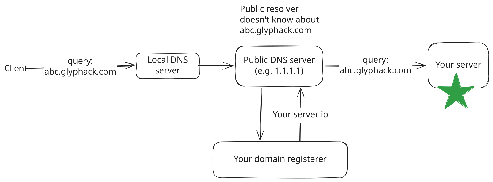
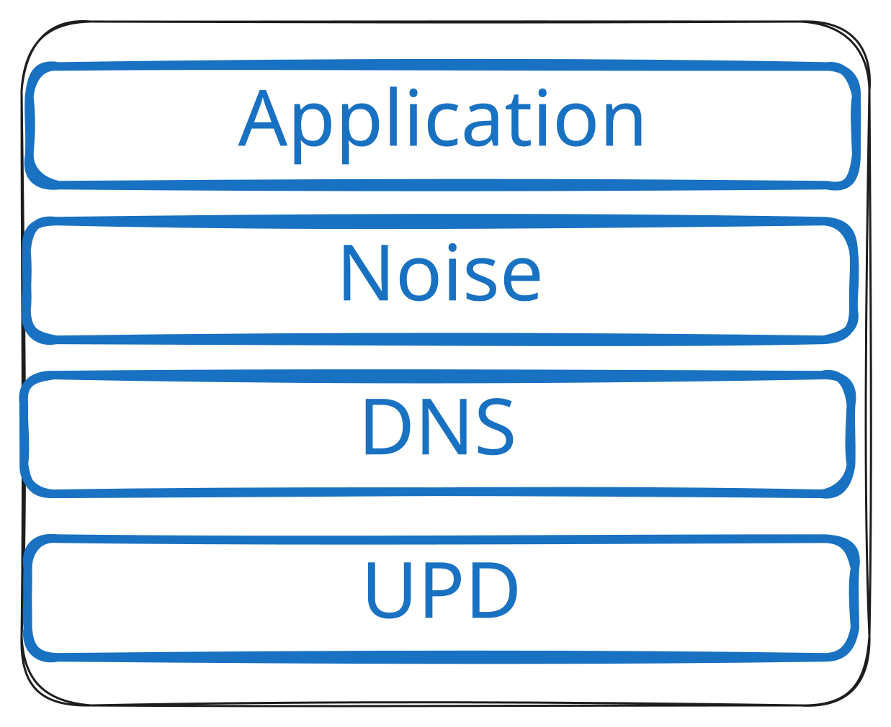

It's always fun to see how a tool can be used to do something that is not its primary purpose.
Earlier this year I was playing around with the idea of developing an app that uses [DNS](/blog/dns-from-scratch/) for transferring data.
I know what you're thinking, "Isn't DNS for figuring out the IP address of a domain?" Yeah, exactly that.

DNS is one of the parts of the internet that works even in the most restricted networks.
That's why there are [many](https://www.bamsoftware.com/software/dnstt/) [VPNs](https://github.com/yarrick/iodine) that use DNS for transferring data.
But using normal web apps with DNS tunneling is painfully slow.
DNS messages are capped at 512 bytes.
These apps are not designed for this constraint; each request contains a few kilobytes of data.
So one HTTP request is split into multiple DNS messages.

My goal was to make an app for communication under such constraints[^1]. Igloo has basic features of sending messages, files, and voice, plus encryption and authentication. All over DNS!


In the rest of this post I'll walk you through how it works.

If you are not familiar with how DNS works, check out [this guide from Julia Evans](https://jvns.ca/blog/2022/02/01/a-dns-resolver-in-80-lines-of-go/).

The application uses a client-server architecture with clients on Windows, Mac, Linux, and Android.

## Finding the Server

We first need to make a connection to the server from our client.
One solution is to use the IP address.
This way the client can make the DNS query directly to the server.
For example:

```text
dig @[Your IP Address] example.com
```

IP addresses are not something that you can rely on all the time.
Also, if the user is in a restricted environment,[^2] he cannot directly send a request to our DNS server.
Imagine a network that only allows him to connect to certain IP addresses. He needs to send the request to an internal DNS server in this case.

The solution that other DNS tunneling apps use is to become the authoritative name server for a domain.
When you buy a domain name, you define where the DNS server that knows the IP address of your domain is.
The name server becomes authoritative for that domain.
Every other DNS server has to ask your server for this domain.
So any request asking for your domain ends up at your server.

In this method the user makes a request to the internal DNS.
When the internal DNS does not know the address, it has to reach out to other DNS servers and ultimately reaches our server.
This is how the user can reach our server without having the direct IP address.

Here's an example: you own `glyphack.com`, and in the domain settings you enter your server IP address as the name server.
Now a user queries `glyphack.com` from a public DNS server.
If this domain is new, the resolver does not know about it, so it queries other DNS servers.
This continues until one DNS server knows your name servers, and it sends the query to your name server.
And in this case the name server is our own server.
So we get all the DNS requests for queries that end with `glyphack.com`, like `example.glyphack.com`.



## Sending Data

Now that we can reach the server, the next challenge is how we encode the data as the DNS request.

In a DNS request you query for a name.
For example, in `msg.glyphack.com` we have one name and three labels: `glyphack`, `com`, and `msg`.
The first two labels are the domain name and cannot be used to store custom data, but extra labels can be used.
For example, `part1.part2.glyphack.com` is still a valid query.

We cannot simply put the binary data in the label data because the name section only allows for [letters and numbers](https://tools.ietf.org/html/rfc1035#section-2.3.1).
One solution for converting binary into characters is base64, but it uses characters like `+` and `/` that are not allowed in DNS.
Also, there's no difference between the characters `A` and `a` in the label, and you cannot simply rely on the fact that the bytes arrive exactly as is since a resolver can also flip the case of characters[^3].
The encoding that is suitable is either base32 or [base36](https://en.wikipedia.org/wiki/Base36).
Since base36 has a few more characters and takes a bit less space than base32, I chose it over base32.

We also need to convert our program data structures into binary.
I used [bincode](https://sr.ht/~stygianentity/bincode/) for this.

Let's see an example of a send-message request in the app:



| Pos  | Description                        |
| ---- | ---------------------------------- |
| 0-0  | Request type for sending a message |
| 1-4  | Recipient name (length prefixed)   |
| 5-7  | Message content (length prefixed)  |



Calculating the base36, we have `13oe9bapr621`.
Then the client sends this request as `13oe9bapr621.glyphack.com`.

What's the size limit in this approach?

Each label is limited to 63 bytes of data.
We're not limited to only one label; however, in total the name should be below 255 bytes.

To calculate how much space we have, we need to take these into account:

- Each label has a length byte in front.
- The domain itself is 12 characters (14 bytes).

63 + 1 + 63 + 1 + 63 + 1 + 48 + 1 + 14

Excluding the length prefixes and domain, we have:

63 + 63 + 63 + 48 = 237

And base36 uses ~ 1.55 characters per byte:

237 / 1.55 = 153

That's how much information we can send in each request.

You see how buying a shorter domain name can leave more space for the application bytes.
But this is still big enough to have a functional and secure application.

## Receiving Data

Other [DNS tunneling programs](https://www.bamsoftware.com/software/dnstt/survey.html) place the response into the answer section of the DNS response.
This part is normally filled with IP address or `TXT` records.
We can use the answer section to include our custom bytes.

- In `A` and `AAAA` records we can directly write bytes.
- `TXT` contains text. So we have to convert the bytes into characters, but with fewer constraints than in the request.

Imagine a request where the client sends information by looking up `AAAA` records for `13oe9bapr621.glyphack.com`.
The server here responds with:

```text
13oe9bapr621.glyphack.com. 300 IN AAAA 0:1301:11a5:2748:99ad:38ab:3f70:e77e
13oe9bapr621.glyphack.com. 300 IN AAAA 188:5711:a5df:1400::
```

As you can see, the full response can be split between multiple `AAAA` records.

The response size is only limited to the 512 bytes.
That is the maximum DNS response size.

## Application Request Response Life Cycle

The application [defines](https://github.com/Glyphack/igloo/blob/f9870ba6f4653168a3468357aa46fd8f1a63c771/shared/src/req_res.rs#L44) request and response types, and works with these types.

The DNS server handles unwrapping the application-defined request data from the DNS request format, and wrapping the responses in the DNS response format.

For example, these are the types for sending a message:

```rust
#[derive(Encode, Decode)]
pub enum RequestBody {
    SendTextMessage(SendTextMessageRequest),
    // Rest of the request types ...
}


#[derive(Encode, Decode)]
pub enum Response {
    SendTextMessage(SendMessageResponse),
    // Rest of the types ...
}

#[derive(Encode, Decode)]
pub struct SendTextMessageRequest {
    pub to: UserName,
    pub content: String,
}

#[derive(Encode, Decode)]
pub struct SendMessageResponse {}

pub type UserName = String;
```

I'm using the [hickory DNS](https://github.com/hickory-dns/hickory-dns/tree/main/crates/proto) library in both client and server to work with DNS request/response.
I wanted to keep the final application small, and using a library didn't sound like a good choice.
But the hickory crate is split in such a good way that you can grab only the parts you need.
In this case I'm only using the message creation and parsing code.

I structured the code in a way that the application logic can mostly ignore the decoding and encoding of the request.
This is not universal since the application has to be mindful of the size limit, but other than that it just works on request/response types.

The following code shows the flow from receiving the request to creating the response:

```rust
fn handle(dns_message: &Message) -> Option<Message> {
    // The question, for example `13oe9bapr621.glyphack.com`.
    let name = dns_message.queries.first()?.name();
    let data_labels = name.num_labels().checked_sub(2)?;
    let mut encoded = String::new();
    for label in name.iter().take(data_labels as usize) {
        encoded.push_str(std::str::from_utf8(label).ok()?);
    }

    // base36 text -> bytes -> request.
    let bytes = base36_decode(&encoded).ok()?;
    let (body, _) =
        bincode::decode_from_slice::<RequestBody, _>(&bytes, config::standard()).ok()?;

    let response = match body {
        RequestBody::SendTextMessage(msg) => {
            println!("message for {}: {}", msg.to, msg.content);
            Response::SendTextMessage(SendMessageResponse {})
        }
        _ => return None,
    };

    // Response -> bytes -> base36 text in a TXT record.
    let bytes = encode_to_binary(response);
    let b36_bytes = vec![base36_encode(&bytes)];
    let mut reply = Message::response(dns_message.metadata.id, dns_message.metadata.op_code);
    reply.metadata.authoritative = true;
    reply.metadata.response_code = ResponseCode::NoError;
    reply.add_answer(Record::from_rdata(
        name.clone(),
        300,
        RData::TXT(rdata::TXT::new(b36_bytes)),
    ));
    Some(reply)
}
```

## Security with Noise

Up until this point we can use DNS to carry requests and responses.
But anyone can see the communication.
An attacker can corrupt or alter messages.

The same problem exists in the browsers, and the solution is TLS.
In communication protocols like this we can use [the Noise Protocol](https://noiseprotocol.org/noise.html).
This is what [dnstt](https://www.bamsoftware.com/software/dnstt/protocol.html) does.

You can use Noise to implement:

- Key exchange between the client and server to establish a connection.
- Integrity check for a message to detect request tampering.
- Message encryption.
- Detection of replay attacks. Someone on the network cannot resend an already processed message and change something on the server.
- Server verification. The client checks the identity of the server when connecting. So a third party cannot impersonate the actual server.

I used the package [mcginty/snow](https://github.com/mcginty/snow), which implements this protocol.

The request that holds the Noise payload is defined as:

```rust
pub struct Request {
    /// 0 = handshake (payload is the 32-byte Noise `e`).
    /// non-zero = transport message (payload is the AEAD ciphertext).
    pub session_id: SessionId,
    pub nonce: u64,
    pub payload: Vec<u8>,
}
```

All clients start with a session ID and nonce set to 0.
This helps with distinguishing handshake from non-handshake requests since the code for handling them is different.
Once the key is exchanged, the client receives a session ID.
This will be used later for decrypting messages and authenticating the user.

During the handshake, the client and server exchange ephemeral keys that are used in the rest of the communication to encrypt data.
In contrast to using a static key for messages, this method gives forward secrecy.

I chose the `NK` [handshake pattern](https://noiseprotocol.org/noise.html#handshake-patterns) because the client has pre-knowledge of the server's static public key.
The server's public key is pinned in the client binary.

When the client and server are done with the handshake, the server stores the derived keys along with a non-constant session ID for the client.
The session ID is something that the client has to send in every request.
We use this to detect who the user is and to decrypt the message.

There's a small catch with replay attacks.
It is common for messages to be lost between the client and the server. From [this section](https://noiseprotocol.org/noise.html#out-of-order-transport-messages) I understood that the client can send the nonce along with the request so the server can update its internal counter and keep processing messages.
I implemented this, but while testing I noticed another kind of failure.
Sometimes the response is lost when it is sent back from the server to the client.
In this case the client retries, and two things can happen:

- Some intermediate DNS resolver has the response in cache and returns it.
- The same request gets to the server again with a nonce that was already used.

The first case is fine, but in the second case I added caching to the server for the last few messages of each session.
So if a client retries the last message, the server does not process it.
Instead, it returns the response from cache.
I can get rid of this cache, but for that I have to make endpoints idempotent.
My preference is to remove messages once the user reads them.
In this case I cannot call this endpoint twice safely.

DNS request size is already limited, so we have to be cautious of the size.
The extra information added to each message for security is 27 bytes in each request and 18 bytes in each response.
But luckily we still have 126 more bytes in each request to implement application features.



## Authentication

For authentication, applications usually use some token like JWT.
But whatever we do, we cannot fit another ~150 bytes in DNS messages.

What we need is a way to know the user is who he says he is.
And we already have a session ID that each connection gets after the handshake.
It is a nice strategy to save space by using the ID to decrypt the message and authenticate the user.
If someone tries to impersonate another user, sending the user session ID is not enough.
He also needs the ephemeral secret key to encrypt the message.
Otherwise, the server fails during decryption of the message.

So this is the authentication process: the server keeps the sessions that are not authenticated in a separate list.
Once the client authenticates with username and password, the server moves that session ID to a new list where authenticated sessions live along with the user identity.
From that point on, the server can determine the username associated with any message that comes in by looking up the session ID in the list.

Keeping unauthenticated sessions in a separate list is a good idea because we can clean them up shortly if they don't authenticate, and keep resources free for other users to connect.

This is interesting because it shows how having control over the full stack makes it possible to simplify things.
The authentication is happening at different levels multiple times (what's the encryption key for this connection, who's the user, etc.).
There might be one answer to all of them, but the layers of abstraction hide it.

## Sending Files and Voice

After all of this we get a secure working chat app.
But the DNS payload is very small. What are the limits?
Well, you can send a short message to anyone.
But for anything bigger, the user has to send sentences one by one.

Also, we cannot send files in this way.
A normal file is at least a few kilobytes.
If we find a way to transfer files, then the user can send a long message as a file.

We don't need to fit a large payload into one DNS message. We can send multiple DNS messages that contain the information for one application message instead.
This way we can even have file and voice messages in the application.

The client asks the server to [allocate a buffer](https://github.com/Glyphack/igloo/blob/f9870ba6f4653168a3468357aa46fd8f1a63c771/shared/src/req_res.rs#L427) with the size of the file for it to write to. The server returns an ID, and the client uses that to upload the large message chunk by chunk.

For files, `zstd` compression works well.
The client compresses the file before sending and decompresses after receiving the file.
The server does not do anything other than taking the file from one user and sending it to another one.

Each file stays on the server.
When the recipient client is online, it receives a message with a file ID.
The client starts the download by sending the file ID to the server, then receives the file data part by part.

Here the client includes the offset in each request so the server does not need to store the state of the download.
So if a message is lost, the client can request it again.

(There's a strange-looking process where the server has to receive the file and decrypt it to store it, then re-encrypt it with the final user's key so the client can open the file after the download.)

Voice works like files, except that text compression does not work well on it. And one second of voice is about 8 KB.
The solution here is to use something like Opus encoding. It can drop the size to ~ 1 KB/sec, which makes voice usable on slow connections.
I didn't do this in the end because I didn't have the time to figure out compiling the library on different platforms and making sure it works.

***

What's next?
As you can see, even with the limited space on DNS, a lot of stuff can be done.

I was in a rush when building this application because I wanted to use it with a few people.
So naturally I skipped some features I didn't need myself.

These are cool things that I want to see happening:

- End-to-end encryption between the clients so the server cannot see the message.
- Group chats.
- Keeping the message history on the client side in a safe way.
- [Parallel routing](https://github.com/EndPositive/slipstream) of DNS requests to increase bandwidth.
- Opus coded ([this binding](https://github.com/SpaceManiac/opus-rs) looks good) for voice encoding/decoding.
- In-app updates so the user can keep using the app through DNS.

[^1]: There are more than just limitations of the DNS specification in play. For example, in my tests sometimes the DNS resolver would drop requests and responses for an extended period of time. So being able to send out one message with one DNS request becomes critical.
[^2]: <https://blog.cloudflare.com/iran-protests-internet-shutdown/>
[^3]: I didn't test with various DNS servers to see how big a problem this can be.
    But just knowing that it can happen is enough for me to not rely on it. <https://developers.google.com/speed/public-dns/docs/security#randomize_case>
