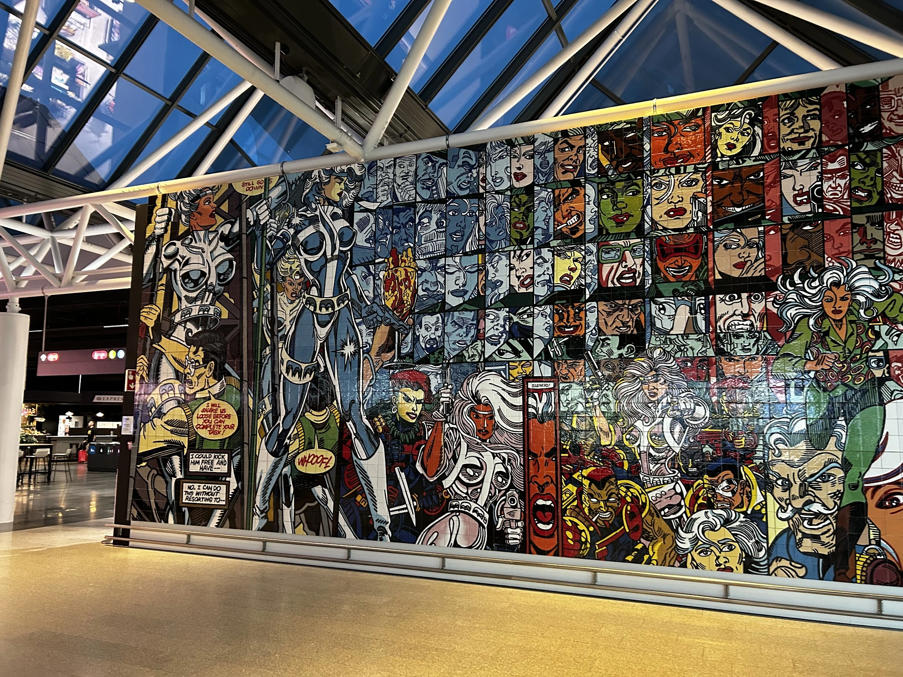
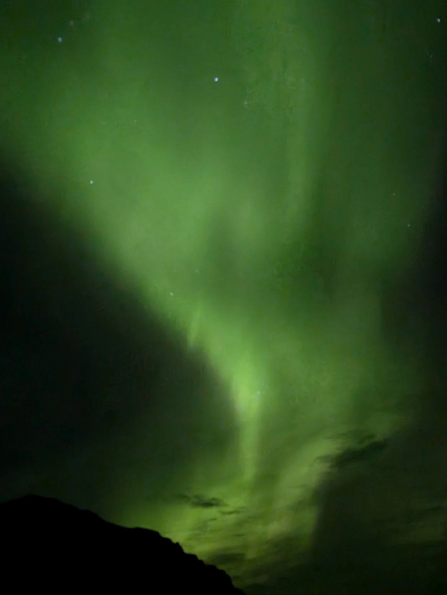
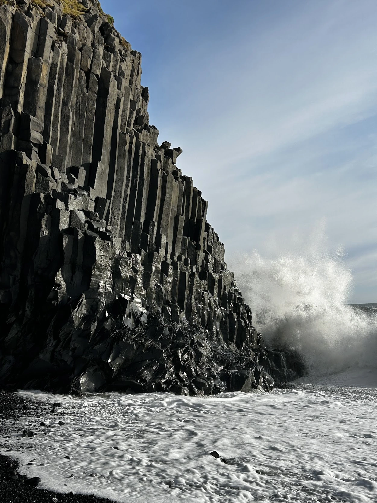
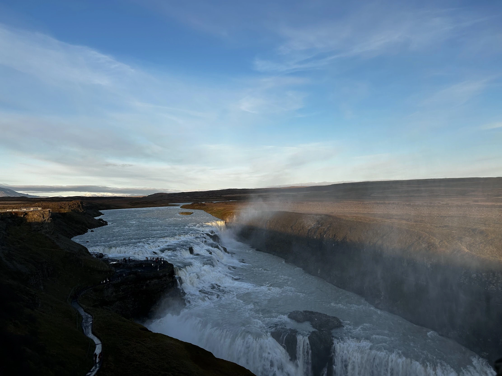
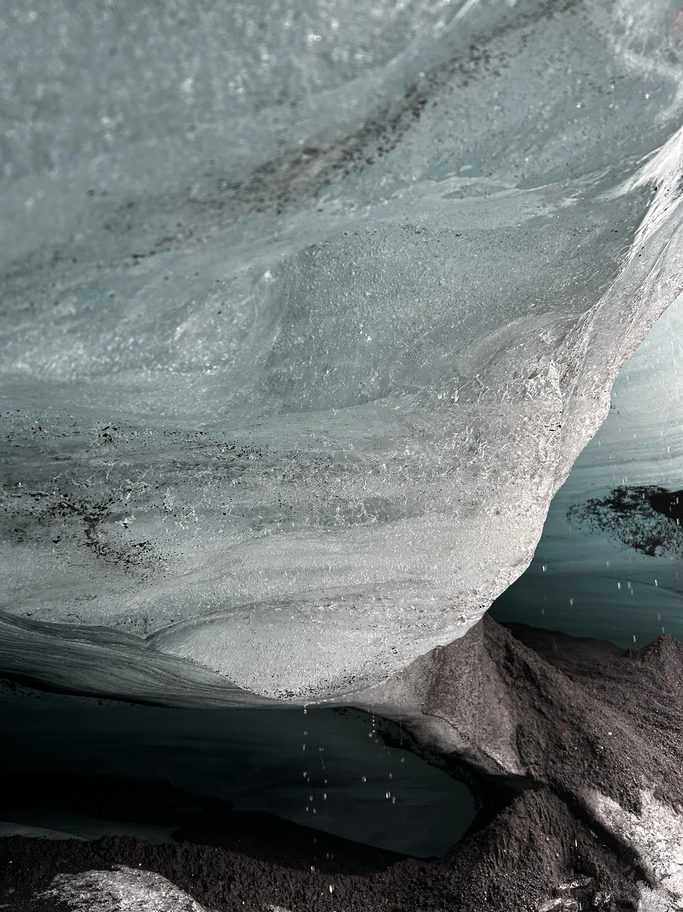
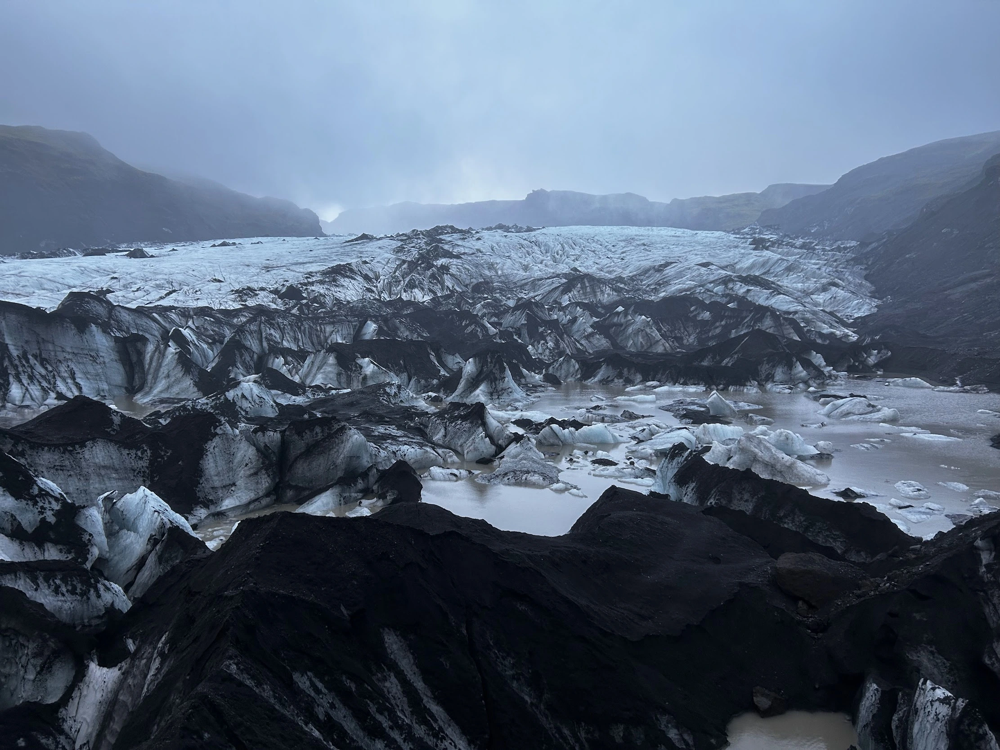
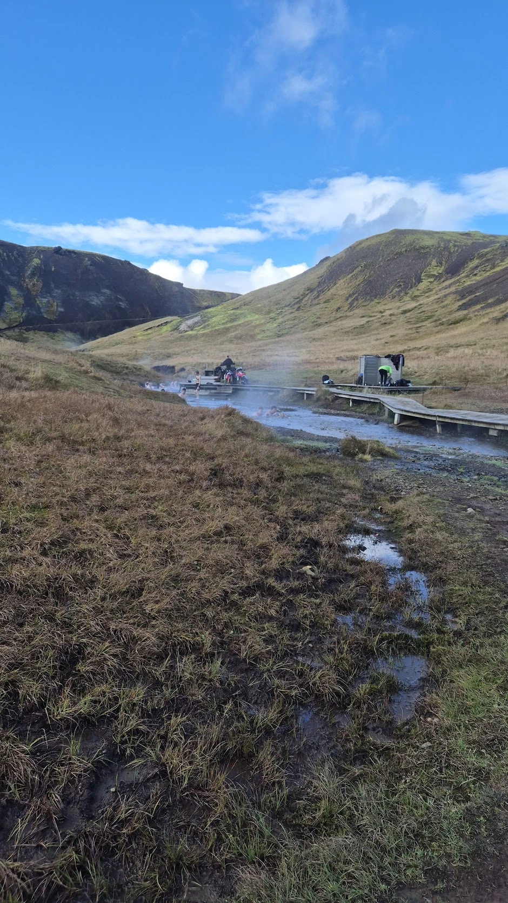

I just spent 7 days in Iceland.
This country really gives a feeling that nobody would live there. It's cold and windy and literally nothing grows there.
(Surprisingly, I didn't encounter any wind farms along the way. Apparently they use a lot geothermal energy for electricity and heating homes.)
Most of the stuff are imported.
As far as the vegetation goes, there's lots of [Lupinus nootkatensis](https://en.wikipedia.org/wiki/Lupinus_nootkatensis) everywhere.

So our plan for the trip was to get a house in the middle of nowhere and visit nearby places. Just walking in the nature is fun because you encounter waterfalls and rivers and big rocks along the way.
I kept starring at the water flow along the way it really beautiful. I made a video of the water to use for my screen saver. The flow is gorgeous.

***

We flew to [Reykjavík](https://www.google.com/maps/place/Reykjav%C3%ADk,+Iceland/@64.1261913,-22.0177698,22224m/data=!3m2!1e3!4b1!4m6!3m5!1s0x48d674b9eedcedc3:0xec912ca230d26071!8m2!3d64.1469868!4d-21.9407552!16zL20vMDZmbGc?entry=ttu&g_ep=EgoyMDI2MTAxOC4wIKXMDSoASAFQAw%3D%3D) and stayed near [Hvolsvöllur](https://www.google.com/maps/place/860+Hvolsv%C3%B6llur,+Iceland/@63.6698753,-20.4092124,29155m/data=!3m1!1e3!4m6!3m5!1s0x48d6e374e0eac9ff:0xde226be5fbbf1e45!8m2!3d63.7511132!4d-20.22292!16zL20vMDMzY3o0?entry=ttu&g_ep=EgoyMDI2MTAxOC4wIKXMDSoASAFQAw%3D%3D) first half of the trip. From here we drove to various places that are close.

I was lucky to see northern lights on the first night.
This is really beautiful when it's strong.
When it's weak you see a lot of colors on the phone but nothing with your own eyes.

Places

[Gljúfrabúi waterfall Iceland](https://www.google.com/maps/place/Glj%C3%BAfrab%C3%BAi/@63.6160892,-20.0924038,12962m/data=!3m1!1e3!4m6!3m5!1s0x48d71eb01553b317:0x966a55b6ec145f2e!8m2!3d63.6208631!4d-19.9864486!16s%2Fm%2F0hhtv1m?entry=ttu&g_ep=EgoyMDI2MDkzMC4wIKXMDSoASAFQAw%3D%3D)

[DC-3 Airplane wreck Eyvindarholt Iceland](https://www.google.com/maps/place/DC-3+Airplane+wreck+-+Eyvindarholt+-+Iceland/@63.6251777,-20.1862073,20934m/data=!3m1!1e3!4m6!3m5!1s0x48d71fa2d905f0b5:0x6ff7faa5597ea651!8m2!3d63.6487223!4d-19.9336201!16s%2Fg%2F11v6_jvcsf?entry=ttu&g_ep=EgoyMDI2MDkzMC4wIKXMDSoASAFQAw%3D%3D)

[Hálsanefshellir Cave](https://www.google.com/maps/place/H%C3%A1lsanefshellir+Cave/@63.404176,-19.0751705,2850m/data=!3m1!1e3!4m6!3m5!1s0x48d74a2a636c8075:0x4177410f191fa085!8m2!3d63.4030376!4d-19.0415791!16s%2Fg%2F11c1rgd0td?entry=ttu&g_ep=EgoyMDI2MDkzMC4wIKXMDSoASAFQAw%3D%3D) - the waves come to the beach unevenly. A game I played there was to wait on the shore for the wave and run away while it's reaching me.

[Dyrhólaey](https://www.google.com/maps/place/Dyrh%C3%B3laey/@63.4042144,-19.1352014,2850m/data=!3m1!1e3!4m6!3m5!1s0x48d749b2488fd399:0x2725ca255462e772!8m2!3d63.4046799!4d-19.1185521!16zL20vMDMzaHNs?entry=ttu&g_ep=EgoyMDI2MDkzMC4wIKXMDSoASAFQAw%3D%3D) - It was quite windy and I saw a bird here flying to the left and then it let the wind to carry it to the right for 3 times. it was like a game.

[Víkurfjara Black Sand Beach](https://www.google.com/maps/place/V%C3%ADkurfjara+Black+Sand+Beach/@63.4165081,-19.0158086,971m/data=!3m1!1e3!4m6!3m5!1s0x48d74a30db9ff191:0x3920036bf6632d98!8m2!3d63.4142559!4d-19.0104132!16s%2Fg%2F11c6_vmhqn?entry=ttu&g_ep=EgoyMDI2MDkzMC4wIKXMDSoASAFQAw%3D%3D) - It's a beach where sand is black. Almost all the beaches I saw there was also black. But this one was more popular maybe because it was in the [Odyssey](https://nicetravel.is/blogs/visit-icelands-black-sand-beach-featured-in-christopher-nolans-the-odyssey/)?

[Brúarfoss](https://www.google.com/maps/place/Br%C3%BAarfoss/@64.2737001,-20.508501,6654m/data=!3m1!1e3!4m6!3m5!1s0x48d699b42950c4e9:0x2611ea18f9caca81!8m2!3d64.2643026!4d-20.5157467!16s%2Fg%2F121ffgqr?entry=ttu&g_ep=EgoyMDI2MDkzMC4wIKXMDSoASAFQAw%3D%3D)

[Gullfoss Falls](https://www.google.com/maps/place/Gullfoss+Falls/@64.3266984,-20.125563,689m/data=!3m2!1e3!4b1!4m6!3m5!1s0x48d6a574af45b6c9:0x2c6347db0b411601!8m2!3d64.3270716!4d-20.1199478!16zL20vMDJnYzA2?entry=ttu&g_ep=EgoyMDI2MDkzMC4wIKXMDSoASAFQAw%3D%3D)

[Strokkur Geyser](https://www.google.com/maps/place/Strokkur+Geyser/@64.3127065,-20.340773,5519m/data=!3m1!1e3!4m6!3m5!1s0x48d65fcb86a21e43:0x13fe408fd8ae0be3!8m2!3d64.3127094!4d-20.3007211!16zL20vMDFzZjdx?entry=ttu&g_ep=EgoyMDI2MDkzMC4wIKXMDSoASAFQAw%3D%3D)

[Katla volcano](https://www.google.com/maps/place/Katla+volcano/@63.6335525,-19.168035,11309m/data=!3m1!1e3!4m6!3m5!1s0x48d0cce7299f34b3:0x19a9671d312273d7!8m2!3d63.6467299!4d-19.1302847!16zL20vMDMxcHJ6?entry=ttu&g_ep=EgoyMDI2MTAwNS4wIKXMDSoASAFQAw%3D%3D) - we got a tour to visit this glacier. The roads are not suitable for any type of car other than what they have. There wer giant mountains of ice and ashes. I've Never seen anything like this before. It was like in the movies with black rocky hills and white background.

[Restaurant Suður-Vík](https://www.google.com/maps/place/Restaurant+Su%C3%B0ur-V%C3%ADk/@63.4223507,-19.0261102,1424m/data=!3m1!1e3!4m6!3m5!1s0x48d74a4740a20c25:0x6a0c0b7ec00eec3c!8m2!3d63.4223368!4d-19.0081731!16s%2Fg%2F12lss31h5?entry=ttu&g_ep=EgoyMDI2MTAwNS4wIKXMDSoASAFQAw%3D%3D) - I ate charr fish for the first time here. It was fine but I would not try it again.

[Skógafoss](https://www.google.com/maps/place/Sk%C3%B3gafoss/@63.5320147,-19.5139566,355m/data=!3m2!1e3!4b1!4m6!3m5!1s0x48d73b7639a58c15:0xf60c71fcdfe7948!8m2!3d63.5320523!4d-19.5113705!16zL20vMDMyZ2pi?entry=ttu&g_ep=EgoyMDI2MTAwNS4wIKXMDSoASAFQAw%3D%3D) was a river coming with blue and white water. It was really beautiful. I glazed into the water for minutes. It was so satisfying to hear the sound of billions of water drops crashing into rocks and turning white and blue.
Yasaman recorded a video for me to put it as my screen saver.

At [Hjorleifshöfði](https://www.google.com/maps/place/Hjorleifsh%C3%B6f%C3%B0i+trailhead/@63.4228988,-18.8163435,7749m/data=!3m1!1e3!4m6!3m5!1s0x48d0b5b56c234863:0xe89f1a6ecff7ecb!8m2!3d63.4238739!4d-18.7660392!16s%2Fg%2F11vkd332pw?entry=ttu&g_ep=EgoyMDI2MTAwNS4wIKXMDSoASAFQAw%3D%3D)  we climbed a bit here and got lost. There were two trails and midway we lost the tracks because there was a huge field once we were on the top of the first hill.
So we went back down the same way.
Then we continued and reached a big sandur.

A car was parked there that smiled and I smlied back and we talked.
coincidentally she was dutch and Yasaman again talked dutch with someone outside Netherlands!

Anyway we walked and in the massive field and in the end there was a huge rock.
The rock inclination was almost 90 degrees and it was wide. standing in front of it was like standing in front of a giant wall.

There was a lot of bird bones and beak in the sand. I wanted to take on home. But didn't in the end.

One of the things with Iceland is that a lot of scenes were filmed there.
The next day we went to see [Skógafoss](https://www.google.com/maps/place/Sk%C3%B3gafoss/@63.5320147,-19.5139566,355m/data=!3m2!1e3!4b1!4m6!3m5!1s0x48d73b7639a58c15:0xf60c71fcdfe7948!8m2!3d63.5320523!4d-19.5113705!16zL20vMDMyZ2pi?entry=ttu&g_ep=EgoyMDI2MTAwNS4wIKXMDSoASAFQAw%3D%3D), and Yasaman told me this was in the Game of  Thrones.

[Sólheimajökull](https://www.google.com/maps/place/S%C3%B3lheimaj%C3%B6kull/@63.5155241,-19.413531,19281m/data=!3m1!1e3!4m6!3m5!1s0x48d730f7084468fb:0x8fb3a0f5f1919015!8m2!3d63.5569444!4d-19.3027778!16s%2Fg%2F122wth2g?entry=ttu&g_ep=EgoyMDI2MTAwNS4wIKXMDSoASAFQAw%3D%3D) is a glacier that you can go by car and then walk. There are a lot of danger signs along the way so you can choose a trail based on your risk appetite.
My favorite part was sitting on a giant chair shaped ice on the water.

on our way back to [Reykjavík](https://www.google.com/maps/place/Reykjav%C3%ADk,+Iceland/@64.1261913,-22.0177698,22224m/data=!3m2!1e3!4b1!4m6!3m5!1s0x48d674b9eedcedc3:0xec912ca230d26071!8m2!3d64.1469868!4d-21.9407552!16zL20vMDZmbGc?entry=ttu&g_ep=EgoyMDI2MTAxOC4wIKXMDSoASAFQAw%3D%3D) we went to [Reykjadalur Hot Spring](https://www.google.com/maps/place/Reykjadalur+Hot+Spring/@64.0474689,-21.2242364,348m/data=!3m2!1e3!4b1!4m6!3m5!1s0x48d6650061b17dfb:0x5868f62a3fcc36b4!8m2!3d64.0474666!4d-21.2216561!16s%2Fg%2F11y6bpz5tq?entry=ttu&g_ep=EgoyMDI2MTAxOC4wIKXMDSoASAFQAw%3D%3D). It's about 1 hour hiking from the parking to get to top of a river.
The river is hot. At the bottom you can feel lukewarm water that's coming form the top. If you hike enough you get to a point where the water is hot. Hot enough to take your clothes off and lay down. It's not very deep so I had to squeeze my body into the water.
Outside was maybe 7 degrees and windy but the water was keeping me warm.

We had lunch at this place [Hofland Eatery](https://www.google.com/maps/place/Hofland+Eatery/@63.9950481,-21.1988024,698m/data=!3m1!1e3!4m10!1m2!2m1!1sRestaurants!3m6!1s0x48d667196d42fb4b:0xb083f9eb2f6f718a!8m2!3d63.9950481!4d-21.1897902!15sCgtSZXN0YXVyYW50c1oNIgtyZXN0YXVyYW50c5IBEHBpenphX3Jlc3RhdXJhbnSaASNDaFpEU1VoTk1HOW5TMFZKUTBGblNVUjRNemx4VTBKUkVBReABAPoBBAgAEDU!16s%2Fg%2F11h4f_j1hg?entry=ttu&g_ep=EgoyMDI2MTAxOC4wIKXMDSoASAFQAw%3D%3D) and I got a giant pizza! I always wanted to get a giant pizza since I was a kid. But I don't do it because I wanna live healthy. So I used the trip as an opportunity to break the rule.
It was made like how pizzas were made in Iran. Reminded me of childhood. With a lot of meat, sausage and thick bread.

In [Reykjavík](https://www.google.com/maps/place/Reykjav%C3%ADk,+Iceland/@64.1261913,-22.0177698,22224m/data=!3m2!1e3!4b1!4m6!3m5!1s0x48d674b9eedcedc3:0xec912ca230d26071!8m2!3d64.1469868!4d-21.9407552!16zL20vMDZmbGc?entry=ttu&g_ep=EgoyMDI2MTAxOC4wIKXMDSoASAFQAw%3D%3D) there was library that turned into a bar during nights. You would thought it's really a bar but downstairs they had chairs and table actually.
There was a band playing there so we walked in. They were singing songs suggested by the audience. It was a fun experience the songs where the old ones that everyone can sing along.
They played [Toto - Rosanna](https://www.youtube.com/watch?v=qmOLtTGvsbM) and I got a throwback to when I learned about Toto.
It was [this scene](https://www.youtube.com/watch?v=3sUic6OsO4s) from South Park that I first heard the first song from them and I loved it.
Thinking about old songs and when I first listened to them brings back some memories.
It's almost a better way to think of the past to play some of these songs and think when I first heard it.

***

That was it!
I don't have any tips other than get a car that can handle mud and uneven roads well because going into these paths is inevitable.

And here's the airport timings for me:

- 1555 arrived at Schipol
- 1610 passed the security
- flight was supposed to be at 1650 and onboarding at 1620 but it got delayed